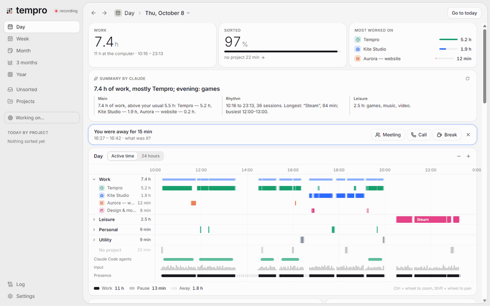
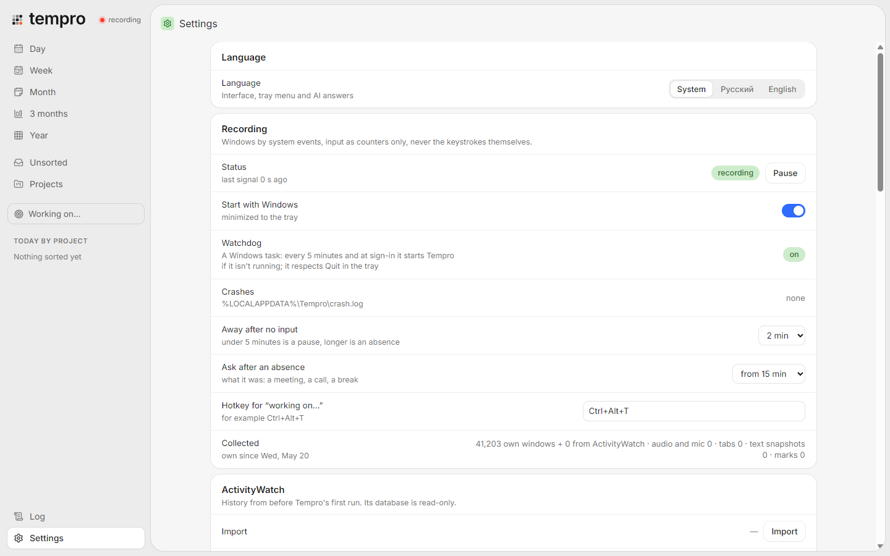
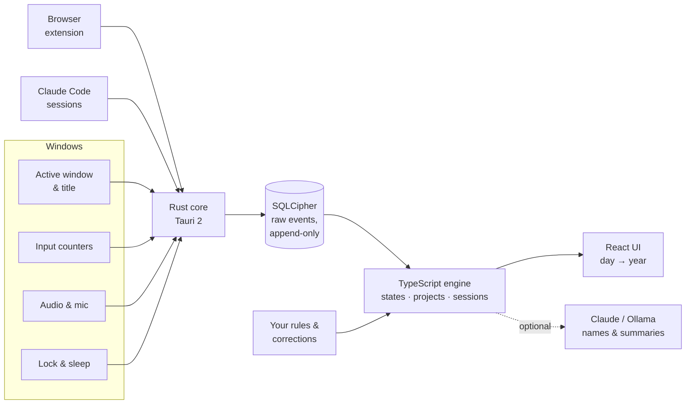

<a id="top"></a>

<p align="center">
  <picture>
    <source media="(prefers-color-scheme: dark)" srcset="docs/assets/hero-dark.svg">
    
  </picture>
</p>

<p align="center">
  <a href="https://github.com/Piwqust/tempro/releases/latest"></a>
  &nbsp;
  <a href="#-take-the-tour"></a>
  &nbsp;
  <a href="docs/DEVELOPMENT.md"></a>
</p>

<p align="center">
  <a href="https://github.com/Piwqust/tempro/actions/workflows/ci.yml"></a>
  <a href="https://github.com/Piwqust/tempro/releases/latest"></a>
  
  
  <a href="LICENSE"></a>
</p>

<p align="center">
  <b><a href="#-take-the-tour">Tour</a></b> ·
  <b><a href="#-what-it-does">Features</a></b> ·
  <b><a href="#-how-it-compares">Compare</a></b> ·
  <b><a href="#-privacy-first">Privacy</a></b> ·
  <b><a href="#-install">Install</a></b> ·
  <b><a href="#-how-it-works">How it works</a></b> ·
  <b><a href="#-faq">FAQ</a></b>
</p>

<br>

> [!NOTE]
> **Based on [ActivityWatch](https://activitywatch.net), reworked for my own needs.** ActivityWatch tells you which windows were open. I wanted to know *what work I actually did*, so Tempro takes the same idea further: it works out the project, the kind of activity and the real working time behind every window, on its own. [Read the story ↓](#-origins)

## ✦ Take the tour

<p align="center">
  
</p>

<p align="center"><sub>Day → Week → Month → 3 months → Year → date picker. Built-in demo mode, made-up data.</sub></p>

## ✦ What it does

<table>
  <tr>
    <td width="33%" valign="top">
      <br>
      <b>Records by itself</b><br>
      <sub>The active window through Windows events, browser tabs, Claude Code sessions, audio and microphone. Five states instead of "active / AFK": a video you watch is not absence.</sub>
    </td>
    <td width="33%" valign="top">
      <br>
      <b>Sorts itself</b><br>
      <sub>Projects from Figma files, editor folders, tab addresses, chats. Correct it once, a rule is saved and the whole history is recomputed. Icons are picked automatically.</sub>
    </td>
    <td width="33%" valign="top">
      <br>
      <b>From a day to a year</b><br>
      <sub>Day, week, month, 3 months and year, a calendar with presets and density, keyboard navigation, heat maps, rhythm and highlights.</sub>
    </td>
  </tr>
  <tr>
    <td valign="top">
      <br>
      <b>Writes the summary</b><br>
      <sub>Optional Claude or local Ollama: a headline for the day, the main work, rhythm, leisure, what changed against last time. In English or Russian.</sub>
    </td>
    <td valign="top">
      <br>
      <b>Private by default</b><br>
      <sub>AES-256 encrypted database, a password for the log or the whole window, details wiped after 30 days, nothing leaves your computer.</sub>
    </td>
    <td valign="top">
      <br>
      <b>Set and forget</b><br>
      <sub>Starts with Windows, lives in the tray, a watchdog brings it back after a crash, background jobs keep running for weeks with the window hidden.</sub>
    </td>
  </tr>
</table>

### Every period, its own answer

| | |
|:---:|:---:|
|  |  |
| **Day.** The timeline by kind of activity, a Claude summary, sessions, *"you were away for 15 min, what was it?"* | **Week.** Each day as a stack of work, leisure, personal and utility, change against last week |
|  |  |
| **Month.** By day and week, projects with their change, *When* and *Highlights* | **3 months.** Three heat-map calendars, weekly bars, comparison with the 3 months before |
|  |  |
| **Year.** A whole year of work on one map | **Projects, rhythm and highlights** for the year: your busiest hours and weekdays |

<details>
<summary><b>More screens</b>: date picker, project page, right-click menu, settings</summary>
<br>

| | |
|:---:|:---:|
|  |  |
| **Calendar in the title**: presets, days tinted by hours of work | **Project page**: days, rules, icon, hourly rate |
|  |  |
| **Its own right-click menu** with actions for what's under the cursor | **Settings**: language, recording, AI, password, data |

</details>

### Move through time from the keyboard

| | |
|---|---|
| <kbd>←</kbd> <kbd>→</kbd> or <kbd>[</kbd> <kbd>]</kbd> | previous / next day, week, month, 3 months or year |
| <kbd>T</kbd> | back to the current period |
| <kbd>D</kbd> <kbd>W</kbd> <kbd>M</kbd> <kbd>Q</kbd> <kbd>Y</kbd> | day, week, month, 3 months, year (physical keys, any layout) |
| <kbd>Ctrl</kbd> + <kbd>L</kbd> | lock the window |
| <kbd>Ctrl</kbd> + <kbd>Alt</kbd> + <kbd>T</kbd> | anywhere in Windows: *I'm working on…* |

## ✦ How it compares

| | **Tempro** | ActivityWatch | Start/stop timers |
|---|:---:|:---:|:---:|
| Records without you doing anything | ✅ | ✅ | ❌ |
| Projects as first-class things | ✅ | ❌ categories only | ✅ typed by hand |
| Learns from your corrections, recomputes history | ✅ | ❌ | ❌ |
| Work / leisure / personal, not just "active" | ✅ | ❌ | ❌ |
| Video and calls don't count as absence | ✅ | ❌ | — |
| Reports from a day to a year, with comparisons | ✅ | partly | ✅ |
| Encrypted database, password lock | ✅ | ❌ | depends |
| Everything stays on your computer | ✅ | ✅ | often cloud |
| Platforms | Windows | Windows, macOS, Linux | many |

<sub>ActivityWatch is a great open-source project and works on every desktop OS; Tempro is narrower and more opinionated. Comparison as of October 2026.</sub>

## ✦ Privacy first


Tempro sees everything you do at the computer, so the data is protected by default.

- 🔐 **Encrypted** with SQLCipher (AES-256). The key lives in Windows Credential Manager, tied to your account.
- 🔒 **Password** for the log or the whole window. It locks again when the window hides or Windows locks. Forgot it? The recovery key clears it.
- 🧹 **Details expire** after 30 days (configurable): titles and addresses are wiped, totals stay.
- 🏠 **Local only.** The server listens on `127.0.0.1`. AI is off by default; when on, only titles and minutes are sent.
- ⌨️ Keys are **counted, never captured**; query strings are stripped; private windows ignored.

<br clear="right">

## ✦ Install

1. **Download** `Tempro_x.y.z_x64-setup.exe` from [**Releases**](https://github.com/Piwqust/tempro/releases/latest) and run it.
2. Tempro installs for your user (no admin rights), appears in the **Start menu** and **Windows search**, starts with Windows and sits in the tray.
3. Optional: the [browser extension](extension/) for tab addresses and video, and an AI key in *Settings → AI*.

**Coming from ActivityWatch?** Tempro finds its database and imports the whole history, categories included.

<details>
<summary><b>Build from source</b></summary>
<br>

You need Rust (MSVC), Bun and the Visual Studio C++ Build Tools.

```powershell
git clone https://github.com/Piwqust/tempro.git
cd tempro
powershell -ExecutionPolicy Bypass -File scripts\release.ps1
```

Want to look around without installing? `cd app && bun install && bun run dev`, then open `http://localhost:1420/?demo&lang=en`. Everything else: [docs/DEVELOPMENT.md](docs/DEVELOPMENT.md).

</details>

## ✦ How it works



- **Raw events are never rewritten.** Projects, states and sessions are computed on top, so a new rule instantly re-sorts your whole history.
- **One engine everywhere.** The same TypeScript code runs in the app window, the browser and the demo mode, and is covered by tests.
- **Long periods stay light.** A year is computed month by month and reduced to daily totals, never held in memory as raw events.

## ✦ Origins

Tempro started as my replacement for [ActivityWatch](https://activitywatch.net). I used it for months and like its core idea: record the active window and idle time, and keep everything on your own machine. But it answers *"which apps were open"*, and my question was *"what work did I do today, for which project, and how much of it was real work"*.

So I reworked the idea for my own needs. Tempro keeps ActivityWatch's way of collecting data and can import its database, and adds what I was missing: projects as first-class things, sorting that learns from corrections, kinds of activity, video and calls that don't count as absence, encryption, and reports for long periods. It is a separate application written from scratch in Rust and TypeScript, not affiliated with the ActivityWatch project.

## ✦ FAQ

<details>
<summary><b>Does it record my keystrokes or take screenshots?</b></summary>
<br>
No. Input is counted per minute (how many keys, clicks, scrolls), never what you typed. Screen text recognition exists for apps whose title never changes, is off by default, and even then keeps only the text, never the image.
</details>

<details>
<summary><b>Do I need the AI?</b></summary>
<br>
No. Recording, sorting by rules, all reports and exports work without it. The AI only names sessions, suggests projects for unsorted time and writes summaries. It can run locally through Ollama.
</details>

<details>
<summary><b>What happens if I reinstall Windows?</b></summary>
<br>
The database key is tied to your Windows account. Save the recovery key from <i>Settings → Data</i> in your password manager; with it, the database opens again.
</details>

<details>
<summary><b>macOS or Linux?</b></summary>
<br>
Not at the moment: the sensors use Windows APIs directly. The engine and the interface are platform-independent, so a port is possible.
</details>

<details>
<summary><b>Can I export my data?</b></summary>
<br>
Yes: CSV for Excel (sessions, hours by day and project, rates) from the week, month, 3-month, year and project screens.
</details>

## ✦ Star history

<p align="center">
  <a href="https://star-history.com/#Piwqust/tempro&Date">
    <picture>
      <source media="(prefers-color-scheme: dark)" srcset="https://api.star-history.com/svg?repos=Piwqust/tempro&type=Date&theme=dark">
      
    </picture>
  </a>
</p>

---

<p align="center">
  <picture><source media="(prefers-color-scheme: dark)" srcset="brand/logo/mark-dark.svg"></picture><br>
  <sub>Made with Rust, Tauri and React · <a href="LICENSE">MIT license</a> · <a href="docs/DEVELOPMENT.md">Developer docs</a> · <a href="#top">Back to top ↑</a></sub>
</p>
