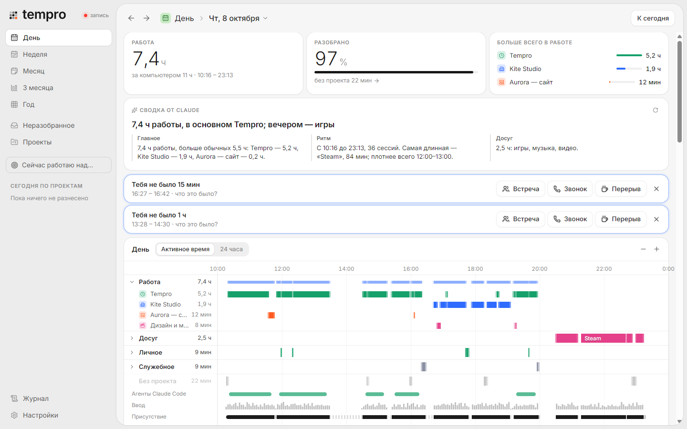
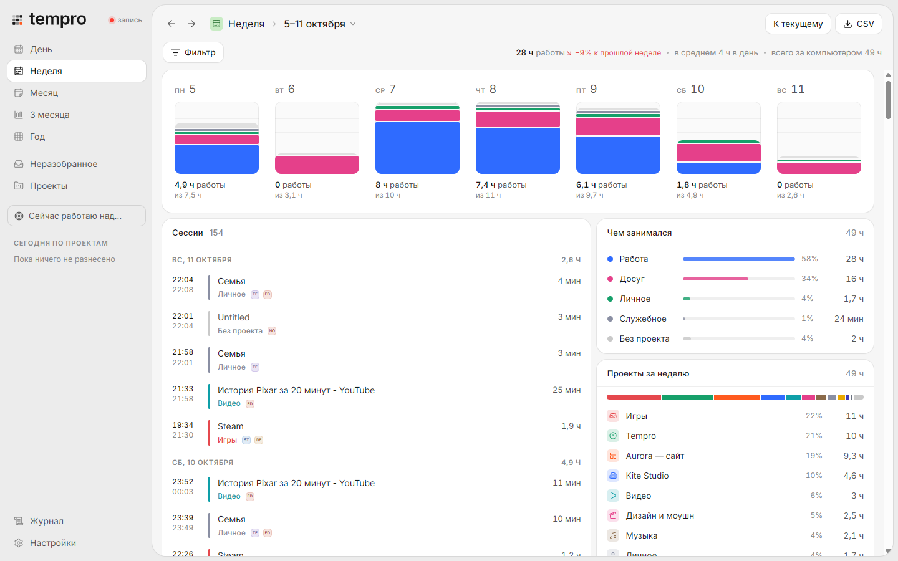
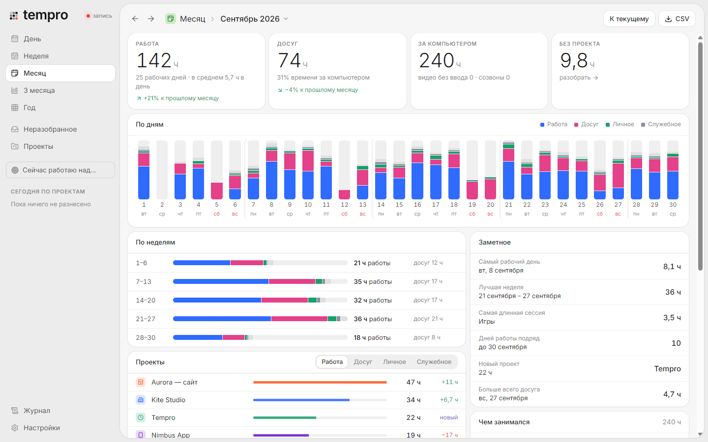
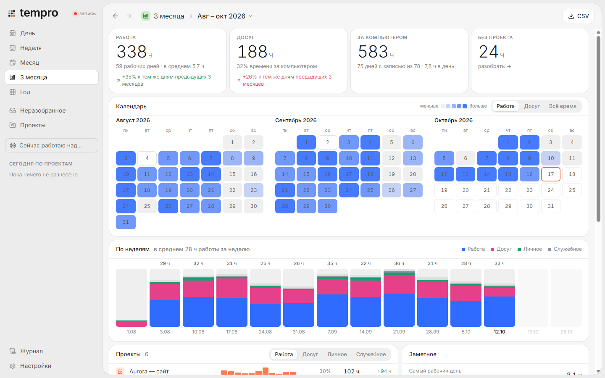
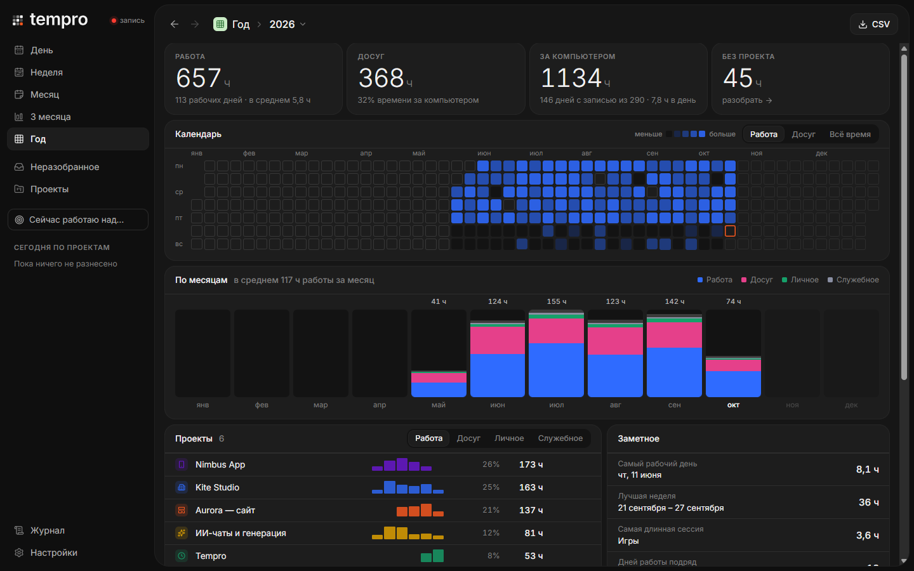
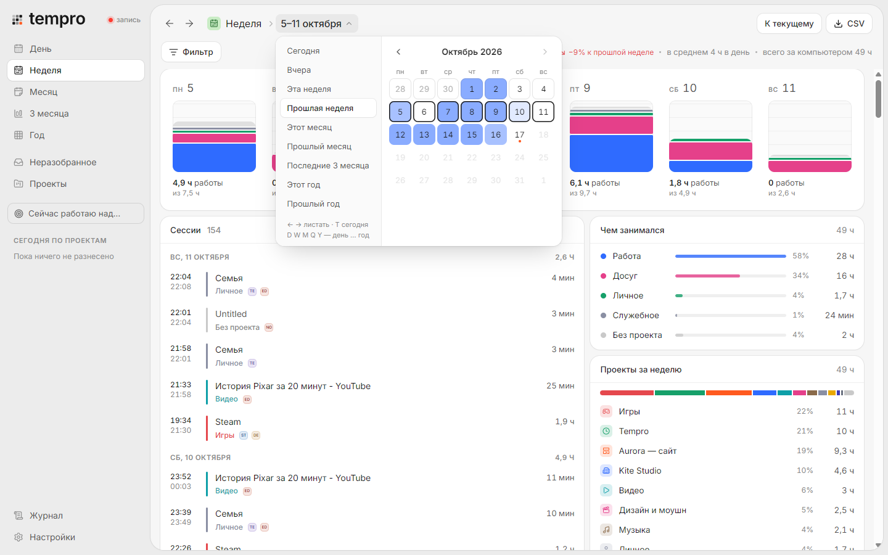
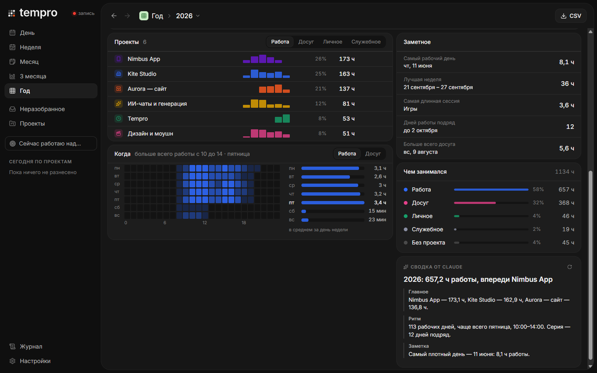
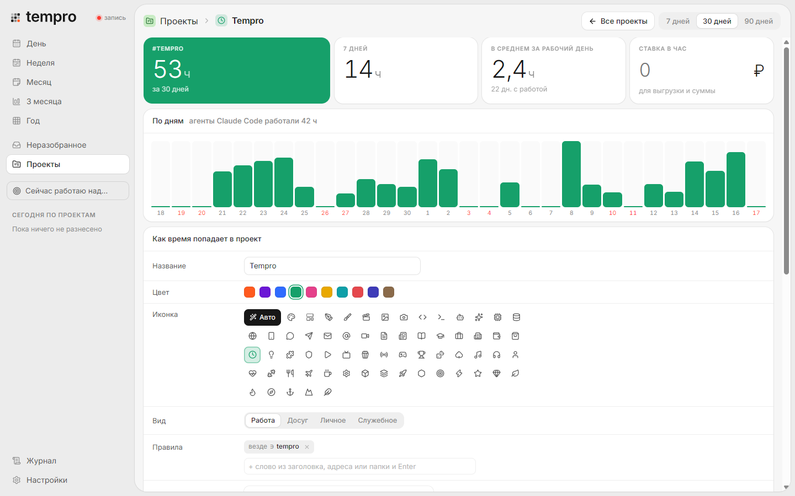
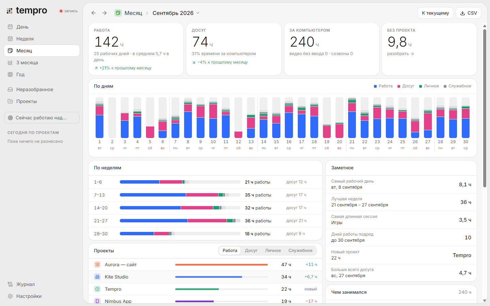
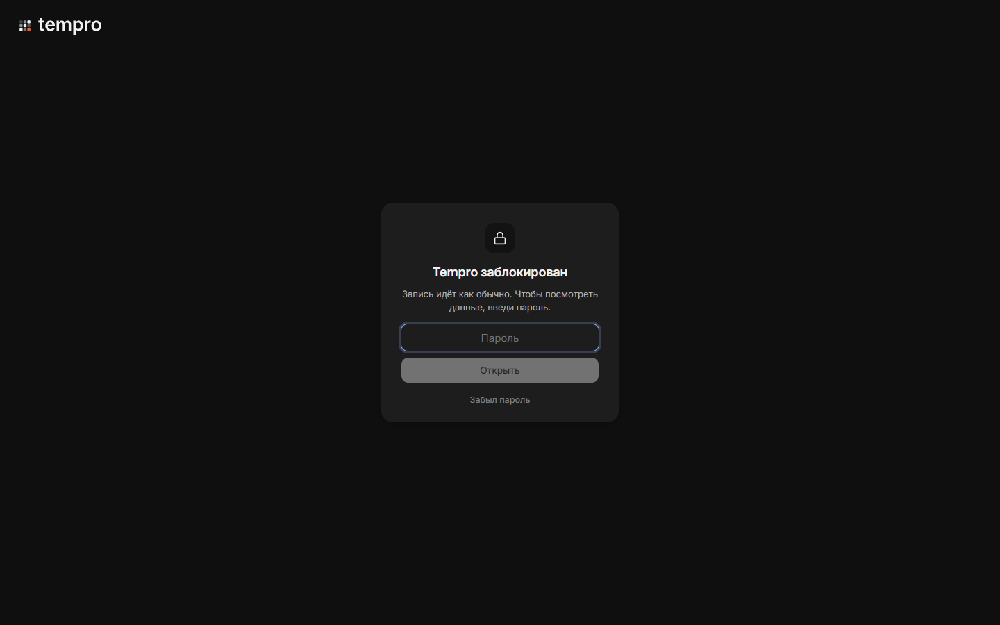

<p align="center">
  <picture>
    <source media="(prefers-color-scheme: dark)" srcset="brand/logo/lockup-dark.svg">
    
  </picture>
</p>

<p align="center">
  <b>Automatic time tracking for Windows that works out what you actually did.</b><br>
  It records your day quietly, sorts it into projects and kinds of activity, and shows it by day, week, month, 3 months and year.
</p>

<p align="center">
  
  
  
  
  
  
</p>

> **Based on [ActivityWatch](https://activitywatch.net), reworked for my own needs.** ActivityWatch tells you which windows were open. I wanted to know what work I actually did, so Tempro takes the same idea further: it automatically figures out the project, the kind of activity and the real working time behind every window. See [Origins](#origins).

<p align="center">
  
</p>

<sub>The interface is in Russian for now. Every screenshot comes from the built-in demo mode with made-up data.</sub>

## Why

Most trackers either want you to press start and stop, or record every window and leave you with thousands of titles to sort. Tempro records in the background, decides which project each moment belongs to and whether it was work at all, and shows an honest total. Install it, forget about it, come back a month later and see where the time went.

## Features

**Records by itself**
- The active window through Windows events (no once-a-second polling), browser tabs through a small extension, Claude Code sessions, audio and microphone, screen lock and sleep.
- Five states instead of "active / AFK": working, watching a video without input, on a call, short pause, away. A video you're watching doesn't count as absence.
- Keyboard and mouse are only counted per minute, never captured.
- Lives in the tray for weeks: starts with Windows, a Task Scheduler watchdog brings it back after a crash, background jobs keep running while the window is hidden.

**Sorts into projects by itself**
- Projects come from window titles, Figma files, editor folders, tab addresses, Telegram chats and coding-agent folders.
- Correct it once and a rule is saved; the whole history is recomputed on the spot.
- Every project has a kind: work, leisure, personal or utility. "8 hours at the computer" becomes "5 hours of work and 2 hours of YouTube".
- Project icons are picked automatically from the name and rules, or chosen by hand.
- Optional AI (Claude, or a local Ollama model) names sessions in plain words, sorts what's left and suggests new projects.

**Shows what matters**

| | |
|---|---|
|  |  |
| **Week**: each day as a stack of activity kinds, change against last week | **Month**: by day and week, projects with their change, rhythm and highlights |
|  |  |
| **3 months**: three heat-map calendars and weekly bars | **Year**: a whole year of work on one map, by month, compared with last year |

- A day timeline grouped by kind of activity and expandable to projects, drawn as density instead of flickering stripes.
- *When*: the hours and weekdays you really work. *Highlights*: busiest day, best week, longest session, working streak, new projects.
- An AI summary with a headline and points (main work, rhythm, leisure, what changed) built from real details, not generic phrases.
- CSV export for Excel: sessions, hours per day and project, hourly rates.

| | |
|---|---|
|  |  |
| **Calendar in the title**: presets, days tinted by hours of work | **Projects, rhythm and highlights** for the year |
|  |  |
| **Project page**: days, rules, icon, hourly rate | **Its own right-click menu** instead of the browser's |

**Fast date navigation**

| Key | Action |
|---|---|
| `←` `→` or `[` `]` | previous / next day, week, month, 3 months or year |
| `T` | back to the current period |
| `D` `W` `M` `Q` `Y` | day, week, month, 3 months, year (by physical key, so any layout works) |
| `Ctrl+L` | lock the window |
| `Ctrl+Alt+T` | anywhere in Windows: "I'm working on…" |

## Privacy

Tempro sees everything you do at the computer, so the data is protected by default.



- **The database is encrypted** with SQLCipher (AES-256). The key is 32 random bytes in Windows Credential Manager, tied to your Windows account; without it the file is noise.
- **A password for the log or the whole window.** Recording continues; looking at the data needs the password. The window locks again when it's hidden or when Windows locks. A forgotten password is cleared with the database recovery key.
- **Details are kept for 30 days** (configurable). After that, window titles and addresses are wiped from disk; the app, the time and the project stay.
- **Nothing leaves your computer.** The local server listens on `127.0.0.1` only and accepts tabs only from its own extension. AI is off by default; when enabled, only window titles and minutes are sent, and the API key lives in Credential Manager.
- Key presses are only counted; query strings are stripped from addresses; private browser windows are ignored; words and apps on your hide list are blanked before they're stored.

<br clear="right">

## Install

**Installer:** download `Tempro_x.y.z_x64-setup.exe` from [Releases](../../releases) and run it. Tempro installs per user into `%LOCALAPPDATA%\Tempro`, shows up in the Start menu and Windows search, starts with Windows and sits in the tray.

**From source:** you need Rust (MSVC toolchain), Bun and the Visual Studio C++ Build Tools.

```
git clone https://github.com/Piwqust/tempro.git
cd tempro
powershell -ExecutionPolicy Bypass -File scripts\release.ps1
```

Demo mode, tests and the architecture are described in [docs/DEVELOPMENT.md](docs/DEVELOPMENT.md).

**Browser extension** (tab addresses and video): open `edge://extensions` or `chrome://extensions`, turn on developer mode, "Load unpacked", pick the [extension/](extension/) folder.

**Coming from ActivityWatch:** Tempro finds its database and imports the whole history, categories included.

## How it works

```
Windows: windows, input, audio, sleep ─┐
Browser extension ─────────────────────┼─► Rust (Tauri 2) ─► SQLCipher: raw events, append-only
Claude Code sessions ──────────────────┘                                │
                                                                        ▼
            React + TypeScript: the engine derives states, projects and sessions from raw events,
            again whenever the rules change; long periods are reduced to daily totals month by month
```

- **Rust:** Windows sensors, storage, encryption, watchdog, password, AI requests.
- **TypeScript:** all of the computation (`app/src/engine`, covered by tests), one code path for the app window, the browser and the demo mode.
- Projects, rules and settings live in the same encrypted database.

## Origins

Tempro started as my replacement for [ActivityWatch](https://activitywatch.net). I used ActivityWatch for months and like its core idea: record the active window and idle time, and keep everything on your own machine. But it answers "which apps were open", and my question was "what work did I do today, for which project, and how much of it was real work". Tempro keeps ActivityWatch's approach to collecting data and can import its database, and adds what I was missing: projects as first-class things, automatic sorting that learns from corrections, kinds of activity, video and calls that don't count as absence, encryption, and reports for long periods. It is a separate application written from scratch in Rust and TypeScript, not affiliated with the ActivityWatch project.

## Limitations

- Windows 10 and 11 only.
- The interface is in Russian for now.
- Summaries and auto-sorting need the Claude API (or a compatible proxy) or a local Ollama; everything else works without them.

## Documentation

- [docs/DEVELOPMENT.md](docs/DEVELOPMENT.md): build, tests, layout, decisions
- [docs/05-design.md](docs/05-design.md): interface principles, tokens, screens
- [docs/02-detection-methods.md](docs/02-detection-methods.md): where the signals come from and how they become states
- [docs/01-activitywatch-analysis.md](docs/01-activitywatch-analysis.md): how ActivityWatch works and what Tempro changes

## License

[MIT](LICENSE)
